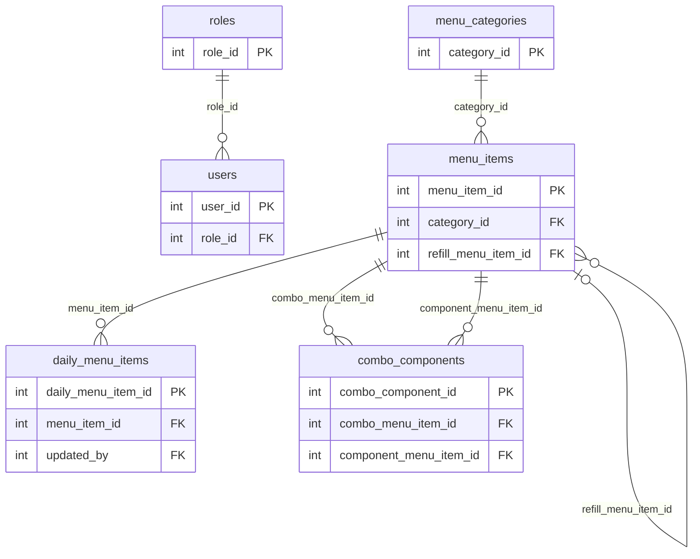
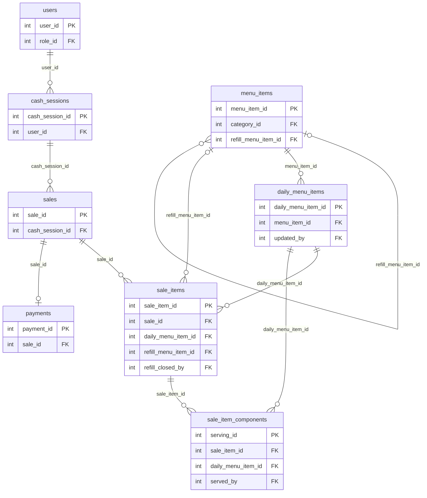
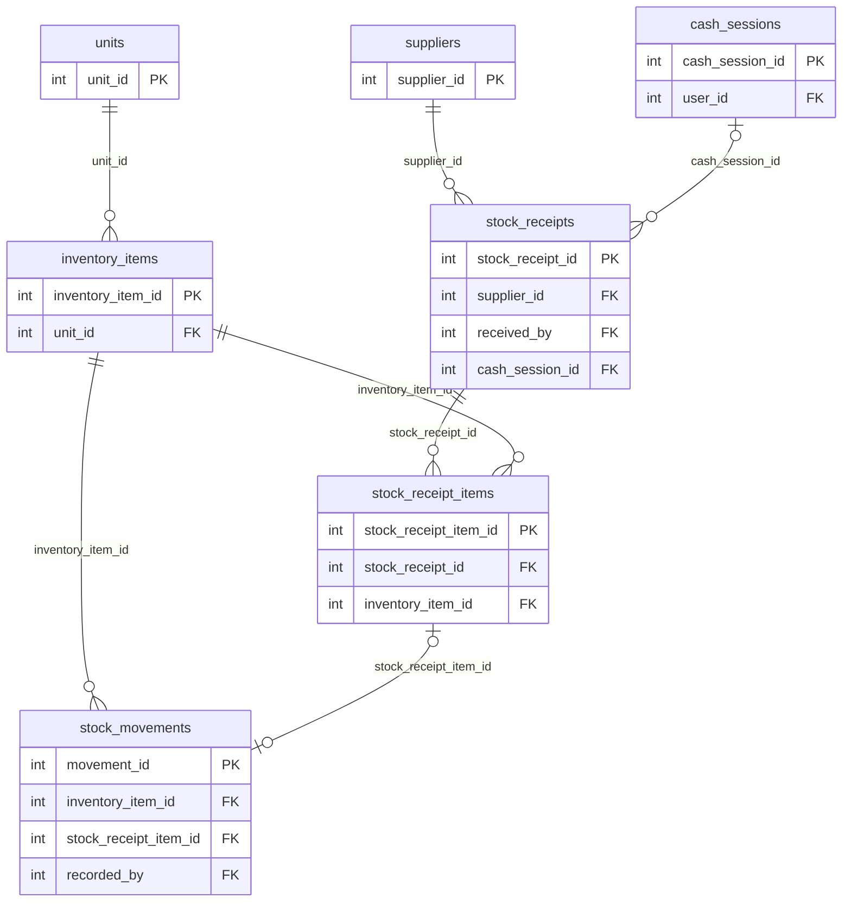
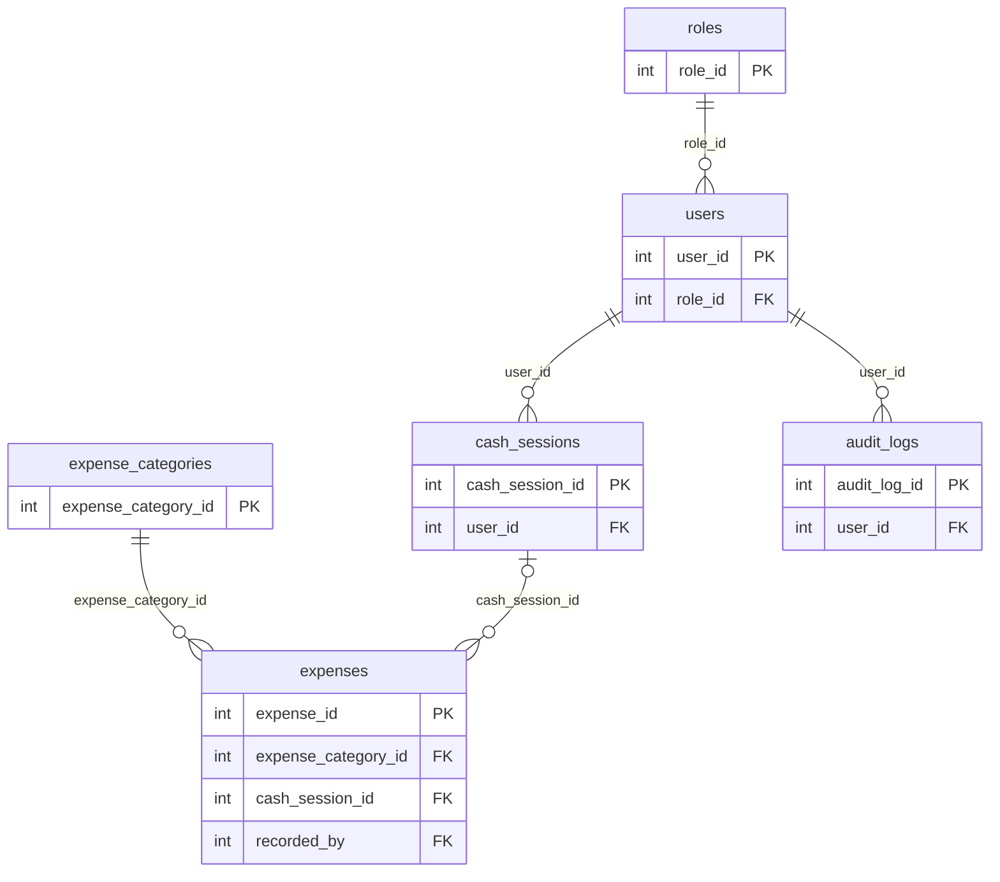

# CarinderEase Database Design and Dictionary

**Family edition | Database: `carinderease_family_db` | 25 October 2026**

This reference defines the 20 tables for a single-branch carinderia application. It supports the agreed Owner, Cashier, and Staff roles, daily menus, fixed combos, cash sales, rice refills, ingredient stock, purchases, expenses, and reconciliation. The SQL schema is authoritative. Some design discussion below describes the original planning rationale; see Implemented_Schema_Notes.md for transaction locking and current implementation details. There is one Owner/Admin account and optional Cashier/Staff accounts.

## Design conventions

- PK means primary key; FK means foreign key; UQ means unique constraint. Composite unique constraints are stated under each table. Required fields have Nullable = No. None in Default means the application must supply a value.
- Every primary key is an auto-incrementing INT UNSIGNED. Foreign-key ID types must match. Use InnoDB and utf8mb4; confirm the installed MySQL-compatible engine before producing the SQL.
- Money uses DECIMAL(12,2), never FLOAT. Ingredient quantities use DECIMAL(12,3); portion quantities are whole numbers. PHP must calculate money using integer centavos or decimal-safe arithmetic.
- DATETIME values use Asia/Manila consistently in this local, single-branch project. menu_date is the local business date. Set updated_at automatically on changes when that field exists.
- Use ON DELETE RESTRICT and ON UPDATE RESTRICT for the foreign keys. Explicitly remove permitted draft child rows first. Do not cascade-delete financial, serving, stock, or audit history.
- Store valid status/type values only. Enforce same-row checks in SQL where supported and validate all business rules in PHP; a foreign key does not enforce role permissions or cross-table conditions.
- Assume one physical cash drawer. Opening float, sales, drawer purchases, and drawer expenses are its only cash movements in the MVP. Separate staff login sessions are not cash drawer sessions.

## Why the design has separate records

The dish catalog describes what can be sold; the daily menu describes what is available on a particular date. Sale items describe what was charged; serving components describe the portions actually allocated or refilled. Raw ingredients are a separate ledger because cooking consumes ingredients in batches. No automatic recipe deduction is implied.

Compared with the earlier blueprint, the cashier is derived from the cash session, only completed sales are persisted, and retry tokens are added to protect checkout, refills, receipts, and stock operations. These refinements avoid inconsistent duplicate fields and duplicate submissions without adding tables.

## Table inventory

| No. | Table | Purpose |
|---|---|---|

| 1 | `roles` | Defines the three application roles. |
| 2 | `users` | Stores login accounts and their assigned role. |
| 3 | `menu_categories` | Organizes counter buttons and the dish catalog. |
| 4 | `menu_items` | Stores reusable dishes, rice, drinks, and fixed combo offers. |
| 5 | `daily_menu_items` | Records each date's offerings, actual prices, and cooked portions. |
| 6 | `combo_components` | Defines the individual products included in each fixed combo. |
| 7 | `cash_sessions` | Tracks the opening and reconciliation of one cashier's cash drawer session. |
| 8 | `sales` | Stores one completed, fully paid counter transaction. |
| 9 | `sale_items` | Preserves the actual products, prices, and refill entitlements purchased. |
| 10 | `sale_item_components` | Records every initial food serving and each additional rice refill. |
| 11 | `payments` | Separately records the cash tender and change for one sale. |
| 12 | `units` | Defines the base unit used by an ingredient or consumable. |
| 13 | `inventory_items` | Stores raw ingredients and consumables, without duplicating stock balances. |
| 14 | `suppliers` | Stores market vendors or other supply sources. |
| 15 | `stock_receipts` | Stores the header of an ingredient purchase and its payment source. |
| 16 | `stock_receipt_items` | Stores quantities and costs of each purchased ingredient. |
| 17 | `stock_movements` | Provides the append-only ledger of ingredient stock changes. |
| 18 | `expense_categories` | Groups operating costs for reporting. |
| 19 | `expenses` | Records posted, fully paid operating expenses and their cash source. |
| 20 | `audit_logs` | Records who changed important application data and why. |

## ERD views

The views below divide one schema into readable modules. Shared tables appear in more than one view. Crow's-foot notation: || means exactly one, o| means zero or one, and o{ means zero or many. All declared foreign keys, including user attribution links omitted from these views for readability, appear in the complete foreign-key map below. The following compact views show primary and relationship fields; the dictionary is authoritative for all fields.

### Accounts and menu

### Sales and serving

### Ingredients and purchases

### Expenses and audit

The sales-to-payments relationship permits zero payments during transaction construction at the SQL constraint level, but the application must commit exactly one payment per sale. A posted receipt line similarly requires exactly one purchase movement. Draft receipt lines have none.

## Complete field dictionary

### 1. roles
Defines the three application roles.

| Field | SQL type | Key | Nullable | Default | Description |
|---|---|---|---|---|---|
| role_id | INT UNSIGNED | PK | No | AUTO_INCREMENT | Role identifier |
| role_name | VARCHAR(30) | UQ | No | None | Owner, Cashier, or Staff |
| description | VARCHAR(255) | None | Yes | NULL | Role explanation |

**Rules:** Seed exactly the three roles. Permissions are defined centrally in PHP; users cannot create arbitrary role names through the UI.

### 2. users
Stores login accounts and their assigned role.

| Field | SQL type | Key | Nullable | Default | Description |
|---|---|---|---|---|---|
| user_id | INT UNSIGNED | PK | No | AUTO_INCREMENT | Account identifier |
| role_id | INT UNSIGNED | FK roles.role_id | No | None | Assigned role |
| owner_guard | TINYINT | UQ | Yes | Generated | 1 for Owner (role 1), otherwise NULL; enforces a single Owner |
| full_name | VARCHAR(100) | None | No | None | Display name |
| username | VARCHAR(50) | UQ | No | None | Unique login name |
| password_hash | VARCHAR(255) | None | No | None | Hashed password, never plain text |
| is_active | BOOLEAN | None | No | 1 | Whether login is allowed |
| created_at | DATETIME | None | No | CURRENT_TIMESTAMP | Creation time |
| updated_at | DATETIME | None | No | CURRENT_TIMESTAMP | Last edit time |

**Rules:** Create the initial owner through a one-time setup process. Only the owner manages accounts. Deactivate used accounts and prevent disabling or demoting the sole Owner. Normalize usernames consistently before duplicate checking.

### 3. menu_categories
Organizes counter buttons and the dish catalog.

| Field | SQL type | Key | Nullable | Default | Description |
|---|---|---|---|---|---|
| category_id | INT UNSIGNED | PK | No | AUTO_INCREMENT | Category identifier |
| name | VARCHAR(50) | UQ | No | None | For example Ulam, Rice, Drinks, Combos |
| is_active | BOOLEAN | None | No | 1 | Available for new items |

**Rules:** A category is a display grouping. item_type on menu_items determines how stock behaves.

### 4. menu_items
Stores reusable dishes, rice, drinks, and fixed combo offers.

| Field | SQL type | Key | Nullable | Default | Description |
|---|---|---|---|---|---|
| menu_item_id | INT UNSIGNED | PK | No | AUTO_INCREMENT | Catalog identifier |
| category_id | INT UNSIGNED | FK menu_categories.category_id | No | None | Display category |
| name | VARCHAR(100) | UQ | No | None | Unique catalog label |
| item_type | VARCHAR(10) | None | No | None | dish, rice, drink, or combo |
| standard_price | DECIMAL(12,2) | None | No | None | Default price for a new daily listing |
| includes_unli_rice | BOOLEAN | None | No | 0 | Whether the offer grants refills |
| refill_menu_item_id | INT UNSIGNED | FK menu_items.menu_item_id | Yes | NULL | Rice item used for free refills |
| is_active | BOOLEAN | None | No | 1 | Available for future daily menus |
| created_at | DATETIME | None | No | CURRENT_TIMESTAMP | Creation time |
| updated_at | DATETIME | None | No | CURRENT_TIMESTAMP | Last edit time |

**Rules:** Prices must be nonnegative. An unli-rice offer must reference an active rice item; otherwise refill_menu_item_id must be NULL. Only dishes and combos can grant refills. If a standalone dish offers unli-rice, its initial rice serving must also be recorded at checkout; the offer includes one initial rice portion. A combo includes its initial rice through combo_components. Deactivation does not change historical sales.

### 5. daily_menu_items
Records each date's offerings, actual prices, and cooked portions.

| Field | SQL type | Key | Nullable | Default | Description |
|---|---|---|---|---|---|
| daily_menu_item_id | INT UNSIGNED | PK | No | AUTO_INCREMENT | Daily listing identifier |
| menu_item_id | INT UNSIGNED | FK menu_items.menu_item_id | No | None | Catalog product |
| menu_date | DATE | UQ group daily_product | No | None | Business date in Asia/Manila |
| selling_price | DECIMAL(12,2) | None | No | None | Price for new purchases that day |
| prepared_qty | INT UNSIGNED | None | Yes | NULL | Total prepared portions; NULL for combos |
| wasted_qty | INT UNSIGNED | None | No | 0 | Prepared portions discarded |
| is_enabled | BOOLEAN | None | No | 1 | Manually offered or paused |
| updated_by | INT UNSIGNED | FK users.user_id | No | None | Last editor |
| created_at | DATETIME | None | No | CURRENT_TIMESTAMP | Creation time |
| updated_at | DATETIME | None | No | CURRENT_TIMESTAMP | Last edit time |

**Rules:** UNIQUE(menu_date, menu_item_id). The UQ group includes both fields. Non-combo rows require prepared_qty >= 0; combo rows require prepared_qty=NULL and wasted_qty=0. Remaining portions are computed, not stored. Prepared quantity cannot fall below served plus wasted quantity. Staff can select active catalog dishes and increase prepared quantities; price changes require Owner permission. Log all quantity and waste changes with reasons. Opening a new day creates new rows instead of overwriting yesterday.

### 6. combo_components
Defines the individual products included in each fixed combo.

| Field | SQL type | Key | Nullable | Default | Description |
|---|---|---|---|---|---|
| combo_component_id | INT UNSIGNED | PK | No | AUTO_INCREMENT | Component definition identifier |
| combo_menu_item_id | INT UNSIGNED | FK menu_items.menu_item_id | No | None | Parent item of type combo |
| component_menu_item_id | INT UNSIGNED | FK menu_items.menu_item_id | No | None | Dish, rice, or drink included |
| quantity | INT UNSIGNED | None | No | None | Portions of this component per combo |

**Rules:** UNIQUE(combo_menu_item_id, component_menu_item_id). Quantity must be positive. Prevent nested combos and self-reference. Every component needs an enabled daily listing for the sale date. Unli-rice combos must contain their configured rice item. Editing a definition affects future purchases only; serving records preserve previous components.

### 7. cash_sessions
Tracks the opening and reconciliation of one cashier's cash drawer session.

| Field | SQL type | Key | Nullable | Default | Description |
|---|---|---|---|---|---|
| cash_session_id | INT UNSIGNED | PK | No | AUTO_INCREMENT | Session identifier |
| user_id | INT UNSIGNED | FK users.user_id | No | None | Cashier or owner responsible |
| opened_at | DATETIME | None | No | None | Opening timestamp |
| closed_at | DATETIME | None | Yes | NULL | Closing timestamp |
| opening_float | DECIMAL(12,2) | None | No | None | Starting cash |
| counted_cash | DECIMAL(12,2) | None | Yes | NULL | Physical count at closing |
| status | VARCHAR(10) | None | No | open | open or closed |

**Rules:** MVP assumes one physical cash drawer and at most one open session in the whole system. Enforce this under a shared database lock, not an unlocked pre-check. Opening float and count cannot be negative. Closed sessions require counted_cash and closed_at. No new sales, drawer purchases, or drawer expenses may be attached after closure. Expected cash and variance are calculated from immutable posted records; do not store duplicate totals.

### 8. sales
Stores one completed, fully paid counter transaction.

| Field | SQL type | Key | Nullable | Default | Description |
|---|---|---|---|---|---|
| sale_id | INT UNSIGNED | PK | No | AUTO_INCREMENT | Sale identifier |
| sale_number | VARCHAR(30) | UQ | No | None | Human-readable transaction reference |
| checkout_token | VARCHAR(64) | UQ | No | None | Prevents duplicate checkout requests |
| cash_session_id | INT UNSIGNED | FK cash_sessions.cash_session_id | No | None | Open drawer session |
| sold_at | DATETIME | None | No | None | Sale timestamp |
| order_type | VARCHAR(10) | None | No | None | dine_in or takeout |
| total_amount | DECIMAL(12,2) | None | No | None | Final total of purchased items |

**Rules:** The session owner is the cashier; avoid repeating cashier_id on sales. Persist only completed sales, making a status column unnecessary for this MVP. An unpaid cart remains temporary and has no stock effect. Require at least one item and exactly one payment at commit. No post-payment refunds or edits are supported in this version.

### 9. sale_items
Preserves the actual products, prices, and refill entitlements purchased.

| Field | SQL type | Key | Nullable | Default | Description |
|---|---|---|---|---|---|
| sale_item_id | INT UNSIGNED | PK | No | AUTO_INCREMENT | Purchased line identifier |
| sale_id | INT UNSIGNED | FK sales.sale_id | No | None | Parent sale |
| daily_menu_item_id | INT UNSIGNED | FK daily_menu_items.daily_menu_item_id | No | None | Purchased daily offering |
| item_name_snapshot | VARCHAR(100) | None | No | None | Name shown at time of purchase |
| quantity | INT UNSIGNED | None | No | None | Number purchased |
| unit_price | DECIMAL(12,2) | None | No | None | Historical price actually charged |
| unli_rice_granted | BOOLEAN | None | No | 0 | Historical refill eligibility |
| refill_menu_item_id | INT UNSIGNED | FK menu_items.menu_item_id | Yes | NULL | Historical refill rice product |
| refill_closed_at | DATETIME | None | Yes | NULL | Visit entitlement closed at this time |
| refill_closed_by | INT UNSIGNED | FK users.user_id | Yes | NULL | User who closed the entitlement |

**Rules:** For unli-rice, create one line with quantity=1 per eligible meal so each entitlement can close separately. Takeout cannot grant refills in this scope. Preserve price and eligibility even when the catalog changes. A refill requires a same-day dine-in sale, an open entitlement, and the configured rice item. Closed timestamp and user are both NULL or both populated. Names and prices are intentional historical snapshots.

### 10. sale_item_components
Records every initial food serving and each additional rice refill.

| Field | SQL type | Key | Nullable | Default | Description |
|---|---|---|---|---|---|
| serving_id | INT UNSIGNED | PK | No | AUTO_INCREMENT | Serving event identifier |
| sale_item_id | INT UNSIGNED | FK sale_items.sale_item_id | No | None | Purchased meal funding this serving |
| daily_menu_item_id | INT UNSIGNED | FK daily_menu_items.daily_menu_item_id | No | None | Actual dish, rice, or drink served |
| quantity | INT UNSIGNED | None | No | None | Portions consumed |
| serving_type | VARCHAR(10) | None | No | None | initial or refill |
| operation_token | VARCHAR(64) | None | No | None | Request identifier used for retry protection |
| served_by | INT UNSIGNED | FK users.user_id | No | None | Cashier or staff recording the serving |
| served_at | DATETIME | None | No | None | Serving timestamp |

**Rules:** UNIQUE(operation_token, sale_item_id, daily_menu_item_id, serving_type). Aggregate identical components within a request. One checkout token can identify its initial serving operation; each refill action gets a new token. Components must be non-combo products on the sale date. Refills must use the saved eligible rice item and have quantity=1 per button press. Lock affected daily rows before checking and recording portions. Initial portions are allocated at payment in this counter-service MVP; do not deduct them again at handover.

### 11. payments
Separately records the cash tender and change for one sale.

| Field | SQL type | Key | Nullable | Default | Description |
|---|---|---|---|---|---|
| payment_id | INT UNSIGNED | PK | No | AUTO_INCREMENT | Payment identifier |
| sale_id | INT UNSIGNED | FK sales.sale_id; UQ | No | None | One payment per sale |
| amount_paid | DECIMAL(12,2) | None | No | None | Net amount retained, equal to sale total |
| cash_tendered | DECIMAL(12,2) | None | No | None | Cash handed over |
| change_given | DECIMAL(12,2) | None | No | None | Cash returned to customer |
| paid_at | DATETIME | None | No | None | Payment timestamp |

**Rules:** cash_tendered >= amount_paid >= 0; change_given = cash_tendered - amount_paid; amount_paid = sales.total_amount. The cashier is determined through the sale's session. Cash only, with no split or partial payments. The application ensures exactly one payment when committing a sale; the unique key alone only guarantees at most one.

### 12. units
Defines the base unit used by an ingredient or consumable.

| Field | SQL type | Key | Nullable | Default | Description |
|---|---|---|---|---|---|
| unit_id | INT UNSIGNED | PK | No | AUTO_INCREMENT | Unit identifier |
| unit_name | VARCHAR(30) | UQ | No | None | Kilogram, liter, piece |
| symbol | VARCHAR(10) | UQ | No | None | kg, L, pc |

**Rules:** Use one base unit per inventory item. Convert purchases into that unit before recording them. Do not change an item's unit after movements exist.

### 13. inventory_items
Stores raw ingredients and consumables, without duplicating stock balances.

| Field | SQL type | Key | Nullable | Default | Description |
|---|---|---|---|---|---|
| inventory_item_id | INT UNSIGNED | PK | No | AUTO_INCREMENT | Inventory identifier |
| unit_id | INT UNSIGNED | FK units.unit_id | No | None | Base measurement unit |
| name | VARCHAR(100) | UQ | No | None | Ingredient or consumable name |
| reorder_level | DECIMAL(12,3) | None | No | 0 | Low-stock threshold |
| is_active | BOOLEAN | None | No | 1 | Available for new operations |
| created_at | DATETIME | None | No | CURRENT_TIMESTAMP | Creation time |
| updated_at | DATETIME | None | No | CURRENT_TIMESTAMP | Last edit time |

**Rules:** On-hand stock equals SUM(stock_movements.quantity_change). Reorder level must be nonnegative. No recipe relationship is included in this MVP: staff explicitly record ingredient issues to the kitchen.

### 14. suppliers
Stores market vendors or other supply sources.

| Field | SQL type | Key | Nullable | Default | Description |
|---|---|---|---|---|---|
| supplier_id | INT UNSIGNED | PK | No | AUTO_INCREMENT | Supplier identifier |
| name | VARCHAR(100) | None | No | None | Supplier name |
| contact_number | VARCHAR(30) | None | Yes | NULL | Optional contact number |
| address | VARCHAR(255) | None | Yes | NULL | Optional address |
| is_active | BOOLEAN | None | No | 1 | Available for new purchases |

**Rules:** Allow a clearly named cash-market supplier when the actual vendor details are unavailable. Do not fabricate contact details. Referenced suppliers are deactivated rather than deleted.

### 15. stock_receipts
Stores the header of an ingredient purchase and its payment source.

| Field | SQL type | Key | Nullable | Default | Description |
|---|---|---|---|---|---|
| stock_receipt_id | INT UNSIGNED | PK | No | AUTO_INCREMENT | Receipt identifier |
| receipt_token | VARCHAR(64) | UQ | No | None | Prevents duplicate receipt creation |
| supplier_id | INT UNSIGNED | FK suppliers.supplier_id | No | None | Source supplier |
| received_by | INT UNSIGNED | FK users.user_id | No | None | User receiving supplies |
| received_at | DATETIME | None | No | None | Actual receipt time |
| reference_number | VARCHAR(50) | None | Yes | NULL | Optional vendor reference |
| payment_source | VARCHAR(10) | None | No | None | drawer or owner |
| cash_session_id | INT UNSIGNED | FK cash_sessions.cash_session_id | Yes | NULL | Required for drawer-paid purchases |
| status | VARCHAR(10) | None | No | draft | draft or posted |
| posted_at | DATETIME | None | Yes | NULL | Posting timestamp |

**Rules:** Purchases are fully paid on receipt. Drafts have no stock or cash effect. Posting requires at least one line and creates exactly one purchase movement per line atomically. Require a valid open session for drawer payments and NULL session for owner payments. Enforce same-business-day receipt/payment for this MVP. No supplier credit, partial payment, tax computation, or backdated drawer posting. Posted receipts are immutable.

### 16. stock_receipt_items
Stores quantities and costs of each purchased ingredient.

| Field | SQL type | Key | Nullable | Default | Description |
|---|---|---|---|---|---|
| stock_receipt_item_id | INT UNSIGNED | PK | No | AUTO_INCREMENT | Receipt line identifier |
| stock_receipt_id | INT UNSIGNED | FK stock_receipts.stock_receipt_id | No | None | Purchase header |
| inventory_item_id | INT UNSIGNED | FK inventory_items.inventory_item_id | No | None | Ingredient received |
| quantity | DECIMAL(12,3) | None | No | None | Positive quantity in base units |
| unit_cost | DECIMAL(12,2) | None | No | None | Nonnegative cost per base unit |

**Rules:** UNIQUE(stock_receipt_id, inventory_item_id): combine repeated ingredients within a receipt. A line total is ROUND(quantity * unit_cost, 2); receipt total is SUM of rounded line totals. Editing and deletion are allowed only while the parent is draft.

### 17. stock_movements
Provides the append-only ledger of ingredient stock changes.

| Field | SQL type | Key | Nullable | Default | Description |
|---|---|---|---|---|---|
| movement_id | INT UNSIGNED | PK | No | AUTO_INCREMENT | Stock event identifier |
| inventory_item_id | INT UNSIGNED | FK inventory_items.inventory_item_id | No | None | Affected ingredient |
| stock_receipt_item_id | INT UNSIGNED | FK stock_receipt_items.stock_receipt_item_id; UQ | Yes | NULL | Source line for purchase movements |
| movement_type | VARCHAR(20) | None | No | None | opening_balance, purchase, kitchen_issue, wastage, adjustment |
| quantity_change | DECIMAL(12,3) | None | No | None | Signed stock increase or decrease |
| reason | VARCHAR(255) | None | No | None | Explanation of the movement |
| operation_token | VARCHAR(64) | UQ | No | None | Prevents duplicate movement requests |
| recorded_by | INT UNSIGNED | FK users.user_id | No | None | Responsible user |
| recorded_at | DATETIME | None | No | None | Movement timestamp |

**Rules:** Purchase movements require the matching receipt line, ingredient, and positive quantity. Non-purchase movements require a NULL receipt line. Kitchen issues and waste are negative; adjustments may be positive or negative but never zero. Opening stock is positive and allowed once per item, before other movements. Lock the inventory_items row before checking or changing its balance. Reject negative resulting stock. Only Owner may record adjustments. Corrections append movements with reasons instead of rewriting history.

### 18. expense_categories
Groups operating costs for reporting.

| Field | SQL type | Key | Nullable | Default | Description |
|---|---|---|---|---|---|
| expense_category_id | INT UNSIGNED | PK | No | AUTO_INCREMENT | Expense grouping identifier |
| name | VARCHAR(50) | UQ | No | None | Rent, LPG, transport, utilities |
| is_active | BOOLEAN | None | No | 1 | Available for new expenses |

**Rules:** Ingredient purchases belong in stock_receipts and must not be recorded again as operating expenses. Decide whether a consumable is inventoried or expensed, then apply that policy consistently.

### 19. expenses
Records posted, fully paid operating expenses and their cash source.

| Field | SQL type | Key | Nullable | Default | Description |
|---|---|---|---|---|---|
| expense_id | INT UNSIGNED | PK | No | AUTO_INCREMENT | Expense identifier |
| expense_category_id | INT UNSIGNED | FK expense_categories.expense_category_id | No | None | Expense classification |
| amount | DECIMAL(12,2) | None | No | None | Positive cash amount |
| paid_at | DATETIME | None | No | None | Payment timestamp and report date |
| description | VARCHAR(255) | None | No | None | Purpose of expense |
| payment_source | VARCHAR(10) | None | No | None | drawer or owner |
| cash_session_id | INT UNSIGNED | FK cash_sessions.cash_session_id | Yes | NULL | Required only for drawer payments |
| operation_token | VARCHAR(64) | UQ | No | None | Prevents duplicate submissions |
| recorded_by | INT UNSIGNED | FK users.user_id | No | None | Owner recording expense |
| created_at | DATETIME | None | No | CURRENT_TIMESTAMP | Creation timestamp |

**Rules:** Require amount > 0. Drawer payments require an open session; owner payments require a NULL session. Record at payment time with no backdated drawer entries. Persist only posted expenses. They cannot be silently edited or deleted; expense reversal is outside this initial version.

### 20. audit_logs
Records who changed important application data and why.

| Field | SQL type | Key | Nullable | Default | Description |
|---|---|---|---|---|---|
| audit_log_id | INT UNSIGNED | PK | No | AUTO_INCREMENT | Audit event identifier |
| user_id | INT UNSIGNED | FK users.user_id | No | None | Authenticated user taking action |
| action | VARCHAR(50) | None | No | None | For example price_changed or stock_adjusted |
| entity_name | VARCHAR(50) | None | No | None | Allowlisted affected table name |
| record_id | INT UNSIGNED | None | No | None | Affected record identifier |
| old_values | TEXT | None | Yes | NULL | JSON text of selected previous values |
| new_values | TEXT | None | Yes | NULL | JSON text of selected new values |
| reason | VARCHAR(255) | None | Yes | NULL | Required for sensitive corrections |
| created_at | DATETIME | None | No | CURRENT_TIMESTAMP | Event timestamp |

**Rules:** record_id is a polymorphic reference, not a foreign key: its table is identified by entity_name. Only the application writes audit logs. Do not expose edit/delete actions, and do not log password hashes, passwords, or session tokens. This table tracks authenticated business changes; failed-login throttling is implemented separately in the authentication layer.

## Complete foreign-key map
Every row below is a declared foreign key. The target record is mandatory unless Nullable is Yes.

| Child table and field | Referenced table and field | Nullable |
|---|---|---|
| `users.role_id` | `roles.role_id` | No |
| `menu_items.category_id` | `menu_categories.category_id` | No |
| `menu_items.refill_menu_item_id` | `menu_items.menu_item_id` | Yes |
| `daily_menu_items.menu_item_id` | `menu_items.menu_item_id` | No |
| `daily_menu_items.updated_by` | `users.user_id` | No |
| `combo_components.combo_menu_item_id` | `menu_items.menu_item_id` | No |
| `combo_components.component_menu_item_id` | `menu_items.menu_item_id` | No |
| `cash_sessions.user_id` | `users.user_id` | No |
| `sales.cash_session_id` | `cash_sessions.cash_session_id` | No |
| `sale_items.sale_id` | `sales.sale_id` | No |
| `sale_items.daily_menu_item_id` | `daily_menu_items.daily_menu_item_id` | No |
| `sale_items.refill_menu_item_id` | `menu_items.menu_item_id` | Yes |
| `sale_items.refill_closed_by` | `users.user_id` | Yes |
| `sale_item_components.sale_item_id` | `sale_items.sale_item_id` | No |
| `sale_item_components.daily_menu_item_id` | `daily_menu_items.daily_menu_item_id` | No |
| `sale_item_components.served_by` | `users.user_id` | No |
| `payments.sale_id` | `sales.sale_id` | No |
| `inventory_items.unit_id` | `units.unit_id` | No |
| `stock_receipts.supplier_id` | `suppliers.supplier_id` | No |
| `stock_receipts.received_by` | `users.user_id` | No |
| `stock_receipts.cash_session_id` | `cash_sessions.cash_session_id` | Yes |
| `stock_receipt_items.stock_receipt_id` | `stock_receipts.stock_receipt_id` | No |
| `stock_receipt_items.inventory_item_id` | `inventory_items.inventory_item_id` | No |
| `stock_movements.inventory_item_id` | `inventory_items.inventory_item_id` | No |
| `stock_movements.stock_receipt_item_id` | `stock_receipt_items.stock_receipt_item_id` | Yes |
| `stock_movements.recorded_by` | `users.user_id` | No |
| `expenses.expense_category_id` | `expense_categories.expense_category_id` | No |
| `expenses.cash_session_id` | `cash_sessions.cash_session_id` | Yes |
| `expenses.recorded_by` | `users.user_id` | No |
| `audit_logs.user_id` | `users.user_id` | No |

## Calculations and reporting

| Metric | Calculation and qualification |
|---|---|
| Remaining prepared portions | daily_menu_items.prepared_qty minus wasted_qty minus the SUM of related sale_item_components.quantity |
| Combo availability | Minimum of FLOOR(component remaining portions / quantity required) across the combo's components; all component listings must be enabled |
| Ingredient balance | SUM(stock_movements.quantity_change) for the ingredient |
| Sale line total | sale_items.quantity multiplied by unit_price |
| Sale total | SUM of its line totals; verified against sales.total_amount at checkout |
| Today's revenue | SUM(sales.total_amount) within the Manila date range |
| Average sale | Revenue divided by completed sale count; show zero when count is zero |
| Stock purchase total | SUM(ROUND(quantity * unit_cost, 2)) for posted receipt lines only |
| Expected drawer cash | Opening float plus net payments for the session minus posted drawer purchases minus drawer expenses |
| Cash variance | Counted cash minus expected cash; negative means shortage |
| Unli-rice usage | SUM of serving quantities where serving_type = refill; contributes zero extra revenue |

Use the net payment amount, not cash tendered, as revenue or retained drawer cash. A PHP 100 sale paid with PHP 150 and PHP 50 change adds PHP 100 to the drawer. Purchases paid separately by the owner do not reduce drawer cash.

Revenue by product uses sale_items. Dish portions consumed uses sale_item_components. Do not allocate the entire combo price to every component or count refills as paid dishes. Cash-based results are not accounting profit.

## Transactions and concurrency

1. Checkout: authenticate and authorize; lock the cash session; load prices and lock all affected daily rows in ascending ID order; validate stock; calculate totals; insert sale, lines, initial servings, and payment; commit together. Any failure rolls back the entire operation. A repeated checkout token returns the existing authorized sale rather than inserting again.
2. Refill: lock the sale item and its rice daily row; check same-day dine-in eligibility, entitlement not closed, and portions available; insert one serving with a unique operation token; commit. Closing an entitlement must lock the same sale-item row.
3. Prepared quantity or waste change: lock the daily row and verify the proposed value against served totals; update it and append an audit entry in the same transaction. Every action that changes available portions uses this lock discipline.
4. Receive stock: lock the applicable cash session first, then the draft receipt and affected ingredient rows in a consistent global order; validate line values and payment source; insert purchase movements; mark posted and write audit data; commit once. Reposting is rejected.
5. Ingredient withdrawal: lock the inventory item, calculate its ledger balance, reject insufficient stock, append one signed movement and audit entry, then commit. Do not use a stale balance shown in the browser.
6. Cash closing: lock the cash session, compute expected cash from posted records, store counted cash and closing timestamp, and mark closed. Every writer of drawer-affecting data must lock and validate the same session first. This prevents purchases or sales being posted during closure.

Define one global lock order in implementation: cash session, transaction headers, sale items, daily menu rows in ID order, then ingredient rows in ID order. Actions without a given resource start with the next applicable resource. Handle deadlocks with a controlled retry using the same operation token.

## CRUD policy

| Record group | Create and read | Update | Delete or deactivate |
|---|---|---|---|
| Users and master catalogs | Authorized roles | Authorized fields | Deactivate referenced records; delete only unused records |
| Daily menu | Owner or Staff within permissions | Quantities and availability; Owner prices | Remove only unused listings; otherwise disable |
| Combo definitions | Owner | Future definitions only | Remove unused definitions; never rewrite served history |
| Draft stock receipts and lines | Owner or Staff | Until posted | Explicitly delete draft lines and header |
| Completed sales and payments | Checkout only | No financial edits | No deletion |
| Serving and stock events | Authorized actions | No historical edits | No deletion |
| Posted purchases and expenses | Authorized actions | No financial edits | No deletion |
| Cash sessions | Owner or Cashier | Close once | No deletion |
| Audit logs | Application writes; Owner reads | No | No |

CRUD is demonstrated across appropriate management modules. Financial history does not need unsafe deletion to satisfy the project requirement. This MVP cannot correct a posted financial mistake with a refund or reversal; that limitation must be disclosed during demonstration and expanded deliberately if required by the chosen business.

## Index plan

In addition to primary keys, unique keys, and indexed foreign keys, add indexes for daily_menu_items(menu_date, is_enabled), sales(sold_at), sale_items(sale_id), sale_item_components(daily_menu_item_id, serving_type), cash_sessions(status), stock_receipts(status, received_at), stock_movements(inventory_item_id, recorded_at), expenses(paid_at), and audit_logs(entity_name, record_id, created_at). Avoid adding a duplicate index when an existing composite key already covers the same leading columns.

## Worked record example

An Adobo Combo is listed at PHP 100 and contains one adobo, one rice, and one drink. It grants dine-in rice refills. Today starts with 10 adobo, 30 rice, and 20 drinks.

| Event | Financial effect | Portion effect |
|---|---|---|
| Sell one combo for PHP 100 | One sale, one sale item, one payment | Three initial serving rows; balances become 9 adobo, 29 rice, 19 drinks |
| Customer tenders PHP 150 | Cash tendered 150; change 50; net retained 100 | None beyond the initial allocation |
| Serve one free rice refill | No new sale or payment | One refill serving; rice balance becomes 28 |
| Customer leaves | Set refill_closed_at and refill_closed_by | Further refills rejected |

The raw rice ledger does not change at checkout or refill. It changes when staff record rice issued to the kitchen. This prevents double deduction.

## Review before SQL implementation

- Confirm the actual carinderia accepts the one-drawer, cash-only, full-payment scope and same-day refill policy.
- Confirm how staff measure prepared portions and whether half portions need to be separate catalog items.
- Confirm the local database engine and version before selecting SQL syntax and constraint support.
- Verify all 20 tables have a justified purpose and that no tables are created solely to reach a count.
- Next step: create the SQL schema, insert reference and sample data, and test relationships and business-rule enforcement before building PHP pages.

Project basis: Semi-Final-and-Final-Topic.pdf and the CarinderEase scope agreed in this conversation. Actual-business assumptions remain subject to field research. This dictionary supersedes conflicting field details in the preliminary blueprint; it does not alter the agreed feature scope.

## Generated drawer constraint

`cash_sessions.open_guard` is a nullable, stored generated TINYINT with a unique index. Open sessions generate 1; closed sessions generate NULL. This enforces a single open drawer. It is computed by the database and must not be supplied by forms or inserts.
