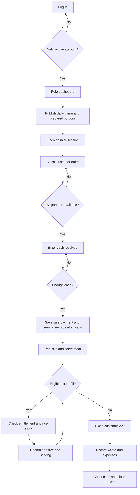
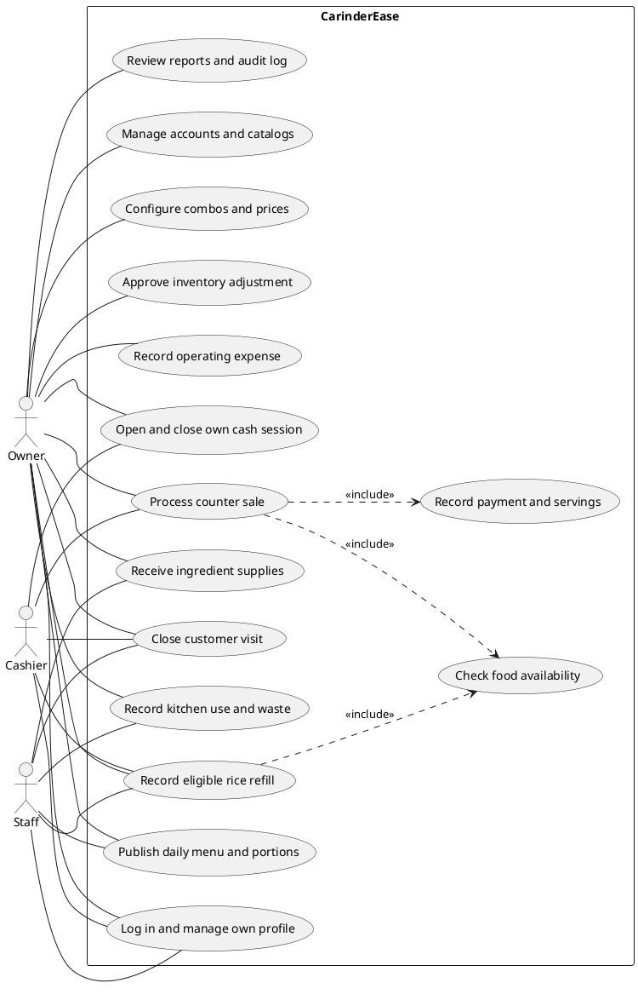
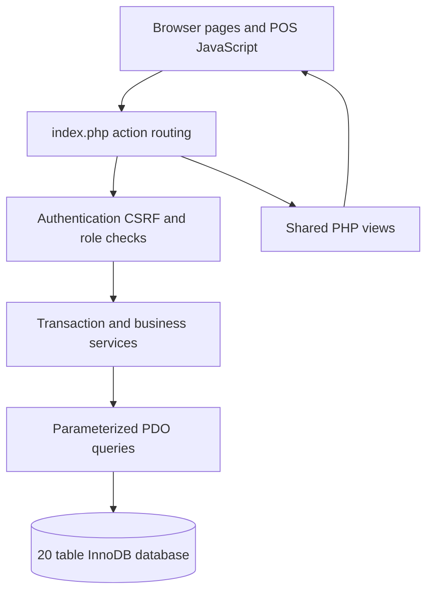

# CarinderEase Workflows and Use Cases

Family edition update: one Owner account also serves as Admin. The Owner creates optional Cashier and Staff accounts directly. Public registration, OTP and business approval are not part of this edition.

## System flowchart

## Use case diagram source

The following is UML use-case notation in PlantUML. It shows direct software actors. Customers and suppliers do not log in and therefore are not direct actors in this version.

## Key scenarios

| Use case | Preconditions | Normal flow | Rejection or recovery |
|---|---|---|---|
| Process sale | Owner or Cashier; own open drawer | Read DB prices; aggregate components; check portions; save sale/items/servings/payment together | Reject insufficient stock or cash; rollback every partial change; retry token prevents duplicates |
| Record refill | Eligible same-day dine-in meal; visit open | Check configured rice; record one free serving | Reject closed visit or unavailable rice; no extra payment |
| Receive stock | Owner or Staff; active supplier and ingredients | Create draft; edit lines; select payment source; post once | Empty receipt rejected; posted receipt immutable; failed transaction rolls back |
| Issue ingredients | Owner or Staff; sufficient stock | Append negative kitchen issue with reason | Reject insufficient stock; no balance overwrite |
| Adjust stock | Owner only | Append signed correction with reason and audit entry | Reject correction resulting in negative balance |
| Close drawer | Own open cash session | Sum cash effects; count cash; close and record variance | No additional sales/expenses/purchases can use the closed session |

## Architecture

## Functional page list

| Route | Purpose |
|---|---|
| login.php | Authenticate active users |
| setup.php | One-time owner account and database creation |
| dashboard | Role-specific live overview |
| pos | Interactive cash counter sales |
| daily-menu | Today's offerings, prices, preparation and waste |
| refills | Eligible meals, free servings and visit closing |
| sales | Searchable completed transactions |
| sale | Itemized transaction and print slip |
| cash-session | Open, reconcile, close, and review sessions |
| catalog | Dish/product CRUD |
| categories | Menu category CRUD |
| combos | Combo component creation, replacement and removal |
| inventory | Current stock and low-stock status |
| ingredients | Ingredient catalog CRUD |
| movements | Stock movement ledger and entry forms |
| receiving | Draft receipts and purchase history |
| receipt | Receipt lines and final posting |
| suppliers | Supplier CRUD |
| units | Measurement unit CRUD |
| expenses | Paid operating expenses |
| expense-categories | Expense category CRUD |
| reports | Eight database reports, printing and CSV |
| users | Team accounts, roles and password reset |
| audit | Sensitive activity history |
| profile | Own name and password changes |
| settings | Operating guide and scope |
